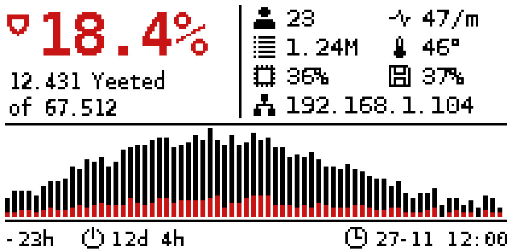
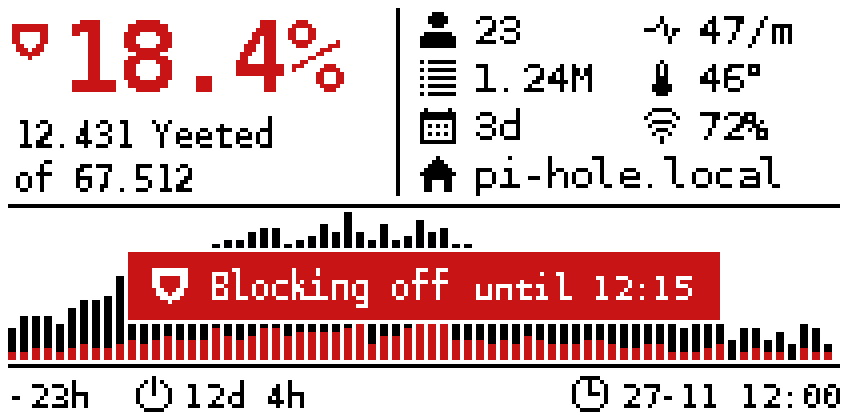
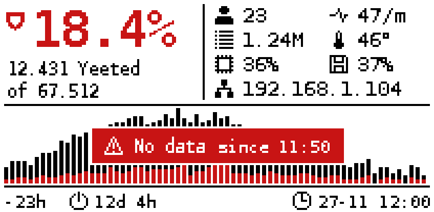
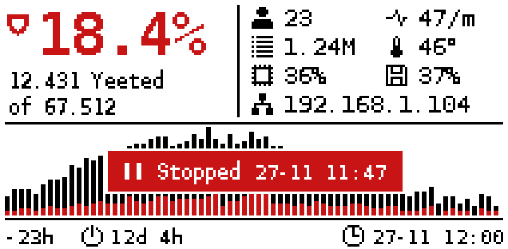
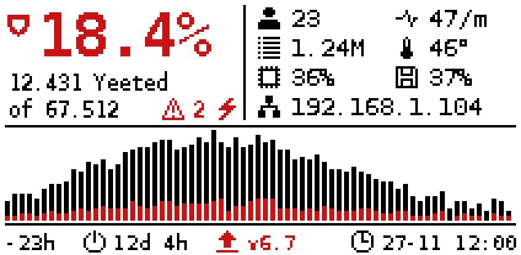

# Pi-hole Display

Pi-hole and system statistics on a Waveshare 2.13 inch three-colour e-paper display.



The top left shows the share of today's queries that was blocked, with the count under it. The grid on the right holds clients, queries per minute, blocklist size and CPU temperature; its lower rows alternate on every refresh between IP address, memory and disk, and host name, blocklist age and WiFi signal. The chart shows the last 23 hours, blocked queries in red. [docs/icons.md](docs/icons.md) explains every icon.

A red bar over the chart reports a state that needs attention:

| | |
|---|---|
|  | Blocking is switched off, with the time it comes back when it was paused with a timer |
|  | Pi-hole does not answer; the numbers are the last ones received |
|  | The display service was stopped; e-paper keeps its last picture, so this one says so |

Red markers under the percentage appear only when there is something to report: a warning triangle with the number of Pi-hole diagnostics messages, and a lightning bolt when the Pi has been under-voltage since boot. An arrow with a version in the footer means a Pi-hole update is available.



## Home Assistant

The display also serves its screen as a picture, at `http://<address of the Pi>:8081/screen.png`. A request draws a new frame with fresh numbers when the last one is older than 2 minutes, so the picture is more recent than the panel, with its own phrase and its own turn of the alternating grid rows.

In Home Assistant, add the **Generic Camera** integration with that address as still image URL, and show the camera in a picture entity card. Port and maximum age are settings: see [docs/configuration.md](docs/configuration.md).

## Hardware

- Raspberry Pi with Pi-hole v6 (built on a Pi Zero W)
- Waveshare 2.13 inch e-Paper HAT (B): 212 x 104 pixels, black, white and red

## Installation

On Raspberry Pi OS (Bookworm or newer), with Pi-hole already installed:

```bash
git clone https://github.com/Cerbrus/piholedisplay.git
cd piholedisplay
sudo ./install.sh
```

`install.sh` installs the Python packages for the display from apt, enables SPI, adds your user to the `pihole`, `spi`, `gpio` and `video` groups, switches the checkout to the `deploy` branch and starts two systemd units:

- `pihole-display.service` draws the screen.
- `pihole-display-update.timer` checks every 5 minutes for a new commit on `deploy`, and restarts the display when there is one.

```bash
journalctl -fu pihole-display          # follow the display
systemctl list-timers pihole-display-update.timer
sudo systemctl reload pihole-display   # redraw now, without waiting for the next refresh
sudo systemctl stop pihole-display     # draws the "Stopped" frame
```

No API key is needed: the display signs in with the CLI password Pi-hole keeps in `/etc/pihole/cli_pw`.

## Configuration

Copy the settings you want to change from `config.json` into `config.local.json`. [docs/configuration.md](docs/configuration.md) lists them all.

## Development

Nothing but Python and Pillow is needed to work on the screen: it renders to a PNG file when there is no display.

```bash
pip install -e ".[dev]"
pytest
ruff check . && ruff format --check .
python -m piholedisplay --demo docs            # redraw docs/screens, docs/icons and docs/icons.md
python -m piholedisplay --preview preview.png  # one frame with live Pi-hole data, on a machine that can reach the API
```

Every push and pull request runs the linter, the tests and the demo render on GitHub Actions; the rendered screens are attached to the run. A green run on `master` moves the `deploy` branch forward, and the Pi picks that up within 5 minutes.

## Licence

[MIT](LICENSE). The Waveshare driver in `piholedisplay/lib` and the DejaVu fonts in `piholedisplay/fonts` come with their own terms, in the file headers and in `piholedisplay/fonts/LICENSE`.
