# Icons

Every icon on the screen is a 9 x 9 pixel bitmap from `piholedisplay/icons.py`.
This page is generated: run `python -m piholedisplay --demo docs` after changing an icon.

| Icon | Name | Meaning |
|---|---|---|
|  | `shield` | Blocked share of today's queries |
|  | `person` | Clients active today |
| 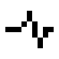 | `pulse` | Queries per minute |
|  | `list` | Domains on the blocklist |
| 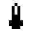 | `thermometer` | CPU temperature |
| 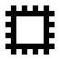 | `chip` | Memory used |
|  | `floppy` | Disk used |
|  | `calendar` | Days since the blocklist was updated |
| 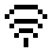 | `wifi` | WiFi signal |
| 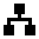 | `network` | IP address |
| 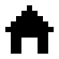 | `home` | Host name |
| 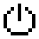 | `power` | Uptime |
| 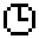 | `clock` | Last refresh |
| 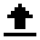 | `update` | Pi-hole update available |
| 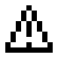 | `warning` | Pi-hole diagnostics messages, or no data |
| 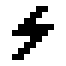 | `bolt` | Under-voltage since boot |
|  | `pause` | Service stopped |
